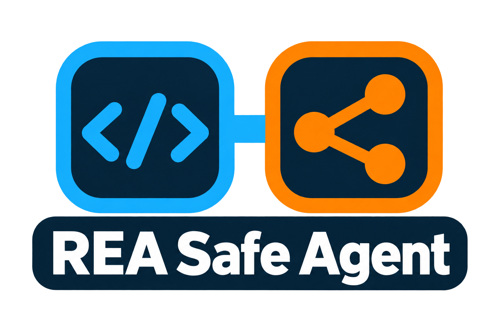
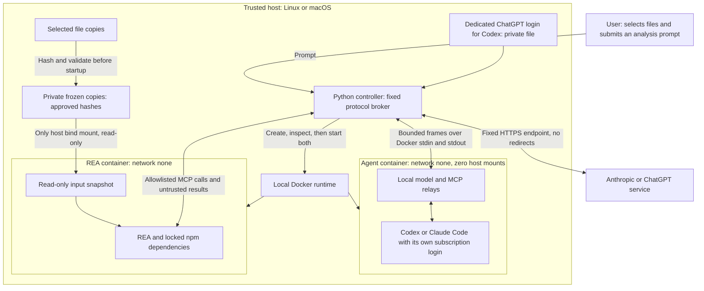

# REA Safe Agent

<p align="center">
  
</p>

[](#how-the-sandbox-works)
[](skills/rea-isolated/references/clients.md)
[](skills/rea-isolated/references/security-model.md)
[](https://www.npmjs.com/package/rea-agents/v/6.7.0)
[](docs/npm-audit.md)
[](#npm-audit-results)
[](#requirements)
[](docs/validation.md)
[](skills/rea-isolated/references/windows-experimental.md)
[](docs/validation.md)
[](docs/validation.md)

**[Quick start](#quick-start)** · [At a glance](#at-a-glance) · [When it helps](#when-it-helps) · [How it works](#how-the-sandbox-works) · [Tools](#available-analysis-tools) · [Step-by-step setup](#step-by-step-setup) · [Security](#security-controls-and-scope) · [Validation](#validation) · [What's new](#whats-new) · [Credits](#credits-and-upstream-rea)

**REA Safe Agent is a skill that builds a safer, contained environment for
analyzing files with REA.**

Especially useful for people who ask an agent to investigate unfamiliar
binaries, archives, application packages or JavaScript. This project provides
a preconfigured way to contain REA and the agent client, limit shared data,
and repeat the verification checks.

- **Contain both processes.** Run REA and its receiving agent in separate
  restricted Docker containers; give the agent zero host mounts.
- **Choose what enters.** Share only frozen, hash-approved copies of selected
  files with REA.
- **Verify the boundary again.** Check the actual container settings, reject
  host tools and exercise real REA analysis after changes.

**Watch the 68-second overview:** what it is for, how the sandbox works and
where its limits are.

https://github.com/user-attachments/assets/3d2b8b9f-f5da-4c90-b569-aa78a668c58e

Full-quality [MP4](media/rea-agent/rea-agent-explainer.mp4) with
[captions](media/rea-agent/rea-agent-explainer.srt) and the
[scene-by-scene script](media/rea-agent/README.md).

## Quick start

Copy this prompt into Codex or Claude Code. The agent reads the guide, checks
your machine and shows you the plan before installing anything:

```text
Set up REA Safe Agent from:
https://github.com/dagoSte/rea-safe-agents

Read SETUP.md, the bundled SKILL.md, the security model and the validation
record. Use this project to analyze untrusted files while containing REA and
the receiving client, limiting shared data and repeating the verification
checks.

Inspect my environment and show the concrete setup plan. Reuse existing
approvals and matching verified artifacts. Request approval only for work
that is not already authorized.

Keep REA, npm and the receiving agent inside separate restricted Docker
containers. Preserve network=none, read-only roots, resource limits and the
22-tool MCP allowlist. The agent must have zero host mounts. Share only
frozen copies of explicitly selected input bytes with REA.

For live analysis, use my own subscription: a `claude setup-token` login
for Claude, or a dedicated ChatGPT login made with `codex-login` for Codex.
Never use API keys, and never reuse my everyday Codex login.

Keep private control files, selected inputs, logins and outputs out of Git
and webroots. Preserve existing global client settings. Never attach REA to
this privileged host conversation or fall back to host execution.

Verify the policy suite, isolation checks and real offline REA analysis
without any model login. Report actual results, image IDs, successful REA
calls, rejected host tools, cleanup and remaining gaps. Claim native
platform coverage only for the host that was actually tested.
```

Prefer to do it by hand? Follow the [step-by-step setup](#step-by-step-setup).

The skill guides **Codex** or **Claude Code** through setup and verification.
The complete Docker workflow has passed on **Linux and macOS (POSIX)**.

**Windows support is experimental.** Native Windows policy tests and the
account-profile check have passed; full Docker Desktop integration remains
unverified. See the [experimental platform record](skills/rea-isolated/references/windows-experimental.md).

**Docker supplies the enforced sandbox.** REA and the receiving agent run in
separate restricted Linux containers. Both have read-only roots, no external
network, no capabilities, no Docker socket, and bounded resources. The agent
has **zero host mounts**; each agent uses its owner's own subscription and no
API key. A small trusted host controller checks both containers before startup
and relays only the approved protocols.

Every npm, REA and analysis-client command stays in Docker. There is no host
execution fallback or global MCP registration.

## At a glance


## When it helps

Use it when an agent must examine files you do not trust: an unknown binary,
archive, application package or JavaScript bundle. The protected sandbox
contains two risks:

- **The file.** REA's parsers read it inside their own container, without
  network and with only frozen copies of the files you chose.
- **The agent.** It reads REA's results inside a second container, without a
  shell, host files or network, so instructions hidden in the file cannot act
  on your machine.

It reduces risk; it does not remove it:

- Analysis is **static**. The file is never executed, so this is not a sandbox
  for watching malware run.
- A Docker, kernel or hypervisor flaw can still break containment.
- The analyzed content reaches the model service (Anthropic or ChatGPT). Do not
  use it on files that must not leave your machine.

## Why we built it

You have an unfamiliar archive, application package or JavaScript bundle and
want an agent to explain what is inside. REA provides the analysis tools.
That workflow also gives unknown bytes to parsers and dependencies, then
returns their results to an agent that may be able to execute commands or
modify files. Both processes need an execution boundary.

We created this skill to guide a repeatable deployment that contains REA
and its receiving client in separate Docker containers, exposes only selected
file copies, restricts the available tools, and verifies the effective setup.
The practical value is a prepared workflow with inspectable controls and real
analysis tests that can be run again after a change.

Maintaining that evidence is part of the project. Updates to Codex, Claude,
Docker or the helpers require fresh verification. Docker containment limits
ordinary access to the host; trusted runtime components, selected data and
model interpretation still have the limits described in the
[security model](skills/rea-isolated/references/security-model.md).

## What is REA?

[REA — Reverse Engineer Anything](https://github.com/morluto/rea) is an open-source
reverse-engineering toolkit, published as
[`rea-agents`](https://www.npmjs.com/package/rea-agents). Its CLI and MCP server
let agents inspect binaries, archives, application packages and JavaScript
applications. Some operations require external analysis providers.

REA Safe Agent adds deployment safeguards around REA and the agent receiving its
results. REA performs the analysis; the agent interprets the evidence. The
upstream project has its own [security policy](https://github.com/morluto/rea/blob/main/SECURITY.md).
The pinned dependencies have a dated clean npm audit. These are useful checks;
they do not constitute an independent security certification of REA.

## How the sandbox works



The trusted **Python controller, Docker CLI and Docker runtime** run on the host.
The REA and agent processes run inside containers. Docker Desktop supplies the
Linux environment on macOS.

The agent communicates through local relays inside its own network namespace.
The controller accepts only a bounded MCP channel to REA and a model channel to
one fixed provider endpoint. It never turns returned text into a host command.
Claude Code signs in with your own `claude setup-token` login; the gateway checks
that each request carries exactly it, re-sends it to Anthropic and never writes
it to disk. Codex uses a dedicated ChatGPT login that stays with the
controller; the contained Codex holds no credential.
Request fields, beta features and content types are allowlisted; provider-side
MCP connectors, cloud files, remote media and prior cloud conversations are
outside this text-analysis profile.

Inputs are recorded as a manifest of paths, sizes and SHA-256 hashes. Before
starting either container, the controller validates all approved bytes and
creates private temporary copies. REA sees only those copies, mounted read-only;
the original directory is never mounted. Added files are excluded and changed
bytes stop the run. Links, Windows reparse points, special files and oversized
inputs are rejected. Review the selected bytes: path filters cannot determine
whether a file contains a secret.

### One analysis from start to finish

1. Approve the two pinned image builds, selected files and private control path.
2. Build with the committed npm lockfiles and lifecycle scripts disabled.
3. Pin both local image IDs and review the input manifest.
4. Verify the actual contained client against a localhost dummy model. Require
   rejection of shell/file-write tools and a successful real REA MCP call.
5. Launch a fresh contained analysis with an explicit model, prompt and your
   subscription login. No real model request is needed for installation verification.
6. Save results as private data; remove both exact containers and temporary
   input copies. Each analysis starts with fresh client state.

The exact commands are in [Step-by-step setup](#step-by-step-setup).
A changed helper, image, deployment or host OS invalidates verification.
Inspection and isolation checks run on every launch. The old direct host MCP
entrypoint and host receiving-session CLI are retired.

## Security controls and scope

| Risk | Enforced control | Remaining trust |
| --- | --- | --- |
| Compromised npm/REA package | REA container, no runtime network/keys/socket, only frozen approved inputs | Selected input bytes can return through MCP; Docker and its kernel remain trusted |
| Instructions hidden in results | Separate agent container, zero host mounts, restricted tools, MCP allowlist, no reverse callbacks | Results can mislead the model; moving them into a privileged conversation changes the boundary |
| Compromised agent process | Same Docker restrictions, no host tools/socket, no credential except Claude's own login, fixed model gateway | The host broker parses untrusted data; Docker/runtime vulnerabilities remain possible |
| Resource abuse | Memory/swap/CPU/process/tmpfs limits, request/byte/depth/time budgets, bounded transcripts | Bounded resource use and authorized model requests can still have a cost |

This is a concrete containment improvement for both REA and the agent. A package
compromise does not automatically give it ordinary host filesystem or shell
access. A Docker/kernel/hypervisor escape could still defeat containment. A
separate VM or machine can add another boundary for higher assurance; it is not
required by this implementation. See the [security model](skills/rea-isolated/references/security-model.md).

## Available analysis tools

REA 6.7.0 advertises 207 tools. This profile exposes 22 of them and enforces
the same allowlist on calls.

| Tool | Purpose |
| --- | --- |
| `open_binary` | Open a target from the frozen `/input` snapshot, without snapshot import |
| `binary_session` | Inspect the active analysis session |
| `inspect_artifact` | Inspect artifact inventory and evidence |
| `inspect_analysis_view` | Read an available analysis view |
| `analyze_javascript_application` | Analyze a selected JavaScript application |
| `close_binary` | Close the session, without snapshot export arguments |

Native executables (ELF, PE, Mach-O) are analyzed by **Ghidra 12.1.4**, REA's
verified provider. It runs inside the REA container with a pinned JDK 21 and no
network. These 16 read-only queries of the open target are exposed:
`binary_overview`, `list_segments`, `inspect_native_load_image`, `list_strings`,
`search_strings`, `list_procedures`, `search_procedures`, `procedure_info`,
`procedure_pseudo_code`, `procedure_assembly`, `procedure_callees`,
`procedure_callers`, `xrefs`, `list_names`, `read_bytes` and `analyze_function`.
None accepts a filesystem path. Annotation tools, snapshot import/export, other
providers (IDA, Hopper, JADX and others) and debuggers stay outside the profile.

Each tool result reaches the model as one text copy of at most 200,000 bytes.
Larger results are cut in the middle with an explicit note asking for a
narrower view; neither client may move them out of the model's sight. The list
tools take no offset, so for binaries larger than a few megabytes use the
search tools or a single address or procedure instead.

Codex can also expose passive MCP resource/question helpers. Reverse MCP
requests, shell/debugger execution, arbitrary tools and hosted model tools are
blocked. Internet, browsers, native macOS/Windows applications, devices and
additional providers need a separately reviewed profile. Unsupported requests stop.

## npm audit results

On **2026-10-18**, audits of both committed dependency lockfiles reported:

| Audited tree | Informational | Low | Moderate | High | Critical | Total |
| --- | ---: | ---: | ---: | ---: | ---: | ---: |
| REA 6.7.0, optional dependencies omitted | 0 | 0 | 0 | 0 | 0 | **0** |
| Codex 0.163.0 + Claude Code 2.1.302 | 0 | 0 | 0 | 0 | 0 | **0** |

Both audits ran inside the pinned Node Docker image. Builds use `npm ci` against
those exact locks. See [raw JSON reports, lock hashes and audit scope](docs/npm-audit.md).
This covers known npm advisories, not OS image packages, malware, undisclosed
flaws or Docker itself. The earlier setup-preview audit is retained separately.

## Requirements

- Python **3.11+** on the host (`python3`).
- A maintained local Docker runtime running **Linux containers**. The dated
  baseline is Desktop **4.95.0+** and Engine **29.8.2+**; check current advisories.
- A Docker-shareable scratch directory and private control/output directories.
  Restrict directory permissions to your account.
- For live analysis only: an explicit supported model ID and a subscription:
  Claude Pro or Max (a `claude setup-token` login) or ChatGPT Plus or Pro (a
  dedicated device-code login made by `codex-login`). API keys are not supported.

Remote daemons, native Windows containers and alternate engines are outside the
profile. Unknown path translations or missing runtime controls fail closed.

## Step-by-step setup

These commands run from the repository root on Linux or macOS. They use
`~/.rea-private` for private files; any directory works if it is private to your
account and outside Git and web server folders. On Linux, use `--context default`
instead of `desktop-linux`. [SETUP.md](SETUP.md) explains each step in depth.

**1. Build the two images** (once, and after every update; about 1.5 GB for REA):

```text
docker --context desktop-linux build --tag rea-local:6.7.0-ghidra-12.1.4-locked skills/rea-isolated/assets
docker --context desktop-linux build --file skills/rea-isolated/assets/agent/Dockerfile --tag rea-agent-local:codex-0.163.0-claude-2.1.302-locked skills/rea-isolated
```

**2. Choose the files.** Put copies of the files to analyze in a private folder.
The originals are never mounted; changed bytes stop the run.

```text
mkdir -p -m 700 ~/.rea-private/control ~/.rea-private/selected ~/.rea-private/runs
cp /path/to/suspicious-file ~/.rea-private/selected/
python3 skills/rea-isolated/scripts/container.py configure --image rea-local:6.7.0-ghidra-12.1.4-locked --context desktop-linux --input-dir ~/.rea-private/selected --output ~/.rea-private/control/rea.json
```

For a file above 8 MB, add `--profile large`. REA then gets 5 GB of memory, 4
CPUs and a 2 GB `/tmp`, so give Docker at least 8 GB. Step 3 tells you when a
selected file needs it, and a run refuses such a file on the standard profile
before any model request.

**3. Choose the agent and verify it.** The example configures Claude; for Codex,
use `--client codex` and `codex.json`. Repeat after any change:

```text
python3 skills/rea-isolated/scripts/agent_container.py configure --rea-config ~/.rea-private/control/rea.json --image rea-agent-local:codex-0.163.0-claude-2.1.302-locked --client claude --output ~/.rea-private/control/claude.json
python3 skills/rea-isolated/scripts/agent_container.py verify --config ~/.rea-private/control/claude.json
```

Verification uses a local dummy model and no login. It must print
`verified-contained-offline`.

**4a. Sign in for Claude** (Claude Pro or Max). In your own terminal window,
not inside an agent chat, run `claude setup-token` on any machine with Claude
Code installed. It opens the browser; approve, and it prints a token starting
with `sk-ant-oat01-`. Copy the whole terminal output (Cmd+A, Cmd+C) and save
only the token. On macOS:

```text
(umask 077; pbpaste | tr -d '\n\r ' | grep -o 'sk-ant-oat[0-9A-Za-z_-]*' | tail -1 > ~/.rea-private/claude-login)
```

On Linux, run `(umask 077; read -rs T && printf '%s' "$T" > ~/.rea-private/claude-login; unset T)`
and paste the token; nothing is shown while you paste. Then clear the terminal.

**4b. Sign in for Codex** (ChatGPT Plus or Pro). First, on chatgpt.com, open
**Settings → Security** and turn on **device code** sign-in for Codex. Then:

```text
python3 skills/rea-isolated/scripts/agent_container.py codex-login --config ~/.rea-private/control/codex.json --output ~/.rea-private/control/codex-login.json
python3 skills/rea-isolated/scripts/agent_container.py codex-models --codex-login ~/.rea-private/control/codex-login.json
```

`codex-login` prints a link and a one-time code: open the link, sign in and
enter the code. This login is used only by REA Safe Agent; never reuse your
everyday Codex login. `codex-models` lists the model IDs your ChatGPT plan
offers; API model names such as `gpt-5.5` are refused for ChatGPT accounts.

**5. Run an analysis.** Pick a ready prompt with `--template` or write your
own with `--prompt-file`, and use a new output folder each time:

| Template | Use it for |
| --- | --- |
| `triage` | A suspicious file: capabilities, indicators, obfuscation and a risk assessment |
| `executable` | Understanding what a program does, function by function |
| `javascript` | A JavaScript application or package: endpoints, secrets, risky code |
| `archive` | The contents of an archive or application package |

```text
CLAUDE_CODE_OAUTH_TOKEN="$(cat ~/.rea-private/claude-login)" python3 skills/rea-isolated/scripts/agent_container.py run --config ~/.rea-private/control/claude.json --model claude-opus-5-5 --template triage --output ~/.rea-private/runs/first-claude
python3 skills/rea-isolated/scripts/agent_container.py run --config ~/.rea-private/control/codex.json --model gpt-6.1-sol --template triage --output ~/.rea-private/runs/first-codex --codex-login ~/.rea-private/control/codex-login.json
```

A template covers every selected file, one at a time; add `--target NAME`
(repeatable) to choose some of them. More files get more model requests,
Claude turns and time, up to fixed caps (128 requests, 80 turns, 90 minutes).

The selected files appear to the agent under `/input/`. The agent's final
report is saved as **`report.md`** in the output folder, headed by the model,
the REA calls and the isolation checks. Print it again, also for older runs:

```text
python3 skills/rea-isolated/scripts/agent_container.py report --output ~/.rea-private/runs/first-claude
```

`result.json` lists the REA calls and isolation checks, and
`agent.stdout.jsonl` holds the full transcript. Treat the report as untrusted
text: the model wrote it from a file you do not trust.

**If something goes wrong**

| Message | Fix |
| --- | --- |
| `Claude needs the user's own setup-token login` | The login file must contain one token starting with `sk-ant-oat`. A double-click copies only part of it; repeat step 4a. |
| ChatGPT asks to enable device code access | Turn it on in chatgpt.com **Settings → Security**, then run `codex-login` again. |
| `The '…' model is not supported when using Codex with a ChatGPT account` | Pick a model from `codex-models`. |
| `A matching native paired verification is required` or `Helpers changed` | Something changed since step 3: configure and verify again with a new config file. |
| `Files above 8 MB need the large REA profile` | Repeat step 2 with `--profile large` and a new `rea.json`, then step 3 with a new config file. |
| `Another run holds this ChatGPT login` | Wait for the other run; if none is running, delete the `.lock` file the message names. |
| `Unapproved provider request fields` | The client sent something outside the reviewed profile, so the run stopped by design. Keep the transcript and report it. |

A failed run keeps its transcripts as `failed.*.local.log` in the output folder.

## Skill installation

The [Quick start](#quick-start) prompt is the easiest route. The repository is
public; the agent can read SETUP.md directly or use a local clone. The shared [skill](skills/rea-isolated/SKILL.md) can be copied in full to
`.agents/skills/rea-isolated/` for Codex or `.claude/skills/rea-isolated/` for
Claude. Invoke `$rea-isolated` or `/rea-isolated`, respectively. Skill discovery
provides instructions; the separate container workflow enforces the boundary.

## Validation

```text
python3 -m unittest discover -s tests -v
python3 tests/verify_runtime.py --context desktop-linux --scratch-root /absolute/private-scratch
```

The workflow runs native policy checks on Linux, macOS and Windows and includes a real
two-container integration job on Linux. Native macOS integration uses Docker
Desktop. Windows support remains experimental until native Docker integration
is verified; passing Windows Python tests alone does not establish that layer.
The [public verification run](https://github.com/dagoSte/rea-safe-agents/actions/runs/39140058024)
passed all four jobs: Linux/macOS/Windows policy checks and native Linux real
analysis through both contained clients. See the [dated validation record](docs/validation.md)
for exact pass/skip counts and remaining Windows runtime coverage.

## What's new

Improvements since the first public release, newest first.

### Large binaries

`container.py configure --profile large` gives REA 5 GB of memory, 4 CPUs, 256
processes and a 2 GB `/tmp`, with a 2 GB Ghidra heap and up to 840 seconds for
Ghidra's first analysis, just under the clients' 900-second tool timeout. On
the standard profile a 25 MB library filled the 256 MB `/tmp`, and the
analysis failed after minutes of work. Pairing now lists selected files above
8 MB, and a run refuses them on the standard profile before any model request.
On the large profile the prompt starts with advice for the model: wait for the
first analysis, begin with `binary_overview`, and search instead of listing,
since full listings are cut to 200 KB. The runtime check runs Claude against
the large profile, so Docker's handling of these limits is verified as well.

### Ready prompts and several files per session

`run --template` replaces a hand-written prompt with one of four reviewed
prompts: `triage`, `executable`, `javascript` and `archive`, kept in
[`skills/rea-isolated/prompts`](skills/rea-isolated/prompts). Each tells the
model to treat everything inside the files as data, to open and close one
file at a time and to say what REA could not determine. A session can now
cover several selected files: `--target` picks some of them, and the model
request budget, Claude's turn limit and the session time grow with the number
of files, within fixed caps. A target that is not among the approved files is
refused.

### Reports you can read

Every analysis now ends with **`report.md`** in its output folder: the
model's final answer, headed by the model, the client and REA versions, the
REA calls made and the isolation checks. Before, the answer had to be dug out
of the JSON transcript. `agent_container.py report --output FOLDER` prints and
rewrites it, also for runs made before this change. The text is cleaned of
terminal control characters and bidirectional overrides, since the model
wrote it from an untrusted file, and the file is private to your account.

### Weekly pinned-version check

REA Safe Agent pins exact versions of REA, Claude Code, Codex, Ghidra, the
Temurin JDK and the Node base image, so every build uses a reviewed, recorded
set of versions and every client version is reviewed before it is trusted.
Pins also go stale. Every Monday a [workflow](.github/workflows/versions.yml)
compares them with the upstream releases:

- Ghidra is compared within the line REA verifies; a newer line is only noted.
- The Node image digest is compared with the tag's current digest, because a
  tag can be rebuilt without a new version number.
- Lockfiles, including each platform build of Claude Code and Codex, the
  reviewed-client constants and the image tags must agree with the pins. The
  constants are read from the code itself, so a comment cannot stand in for
  them, and a half-finished update is reported, not taken as current.
- Prereleases and malformed answers, such as `00.1.0` or digits from another
  script, are reported as "could not check", never as current. Redirects are
  refused, so the workflow token cannot follow one.

While anything is behind, inconsistent or uncheckable, one labelled issue,
**Pinned versions to review**, lists it with every file that still mentions
the old version, including forms like `v1.2.3`; the list comes from Git, and
if Git cannot list the files the issue says so. Dated records such as the
validation log are listed apart and left as history. The issue closes once everything is current. Runs never
overlap, and an issue someone else opened with the same title is never touched.

Run the same check locally with `python3 tools/check_versions.py`; it exits
with 1 while anything is behind, inconsistent or uncheckable. It never
changes a pin: an update stays a reviewed change, with a new checksum or
digest, rebuilt images and a fresh verification.

## Credits and upstream REA

Developed by **Stefano D’Agostino**.

Thank you to the authors, maintainers and contributors of
[REA — Reverse Engineer Anything](https://github.com/morluto/rea) for building
and sharing the reverse-engineering toolkit that makes this workflow possible.
REA does the analysis; our skill guides the creation and verification of the
contained environment for REA and the agent receiving its results.

This repository contains the launcher, skill, references and
[original project branding](docs/branding.md). Upstream REA, agent clients and
their dependencies retain their own licenses.

## Star History

[](https://www.star-history.com/#dagoSte/rea-safe-agents&Date)
